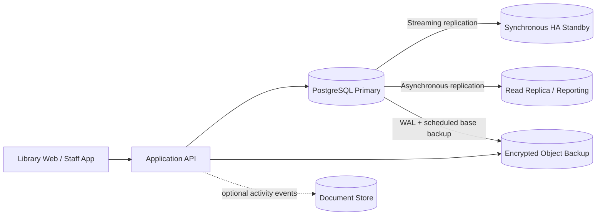

# Portfolio 5 — Proposed distributed and cloud database design

## Logical architecture

## Roles and consistency
- **PostgreSQL primary:** authoritative source for members, catalogue, copy status, loans and loan items. All issue/return decisions and writes go to the primary.
- **HA standby:** streaming replica for failover. Synchronous replication may reduce acknowledged-transaction loss but adds commit latency and depends on topology; automated failover must fence the old primary to avoid split brain.
- **Reporting replica:** asynchronous read replica for dashboards and analytics. It may lag; the UI must label report freshness and must not use this replica to decide whether a copy can be issued.
- **Optional document store:** event/audit history only, with an explicit ownership and reconciliation strategy. It is not a second source of truth for inventory.
- **Backups:** encrypted base backups plus WAL archiving, retention controls, separate credentials and periodic restore drills.

## Availability, recovery and scaling
Proposed service objectives for planning are **RPO ≤ 5 minutes** and **RTO ≤ 60 minutes**. These are targets, not measured or guaranteed results. Actual recovery depends on replication mode, failure detection, operator response, backup integrity and tested runbooks. Start with vertical scaling and read replicas; introduce sharding only after measured data volume or write distribution justifies its operational complexity. Partitioning large historical loan/event tables by date may be considered before sharding.

## Security and operations
Use private networking, TLS in transit, encryption at rest, least-privilege service roles, separate read/reporting credentials, managed secrets, audit logging, patching and tested point-in-time recovery. Monitor replication lag, connection saturation, storage growth, backup age, failed jobs and restore-test outcomes. Document failover authority and ensure the application reconnects safely.

**Status:** this is a design proposal. No PostgreSQL cluster, cloud resources, replica or backup service was deployed in this exercise.
